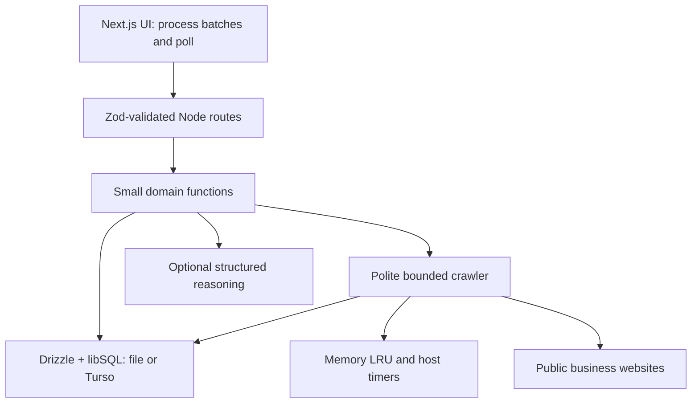

# Deal Radar — revised Phase 1 architecture

Status: design contract, superseding the previous Phase 1 document. Application code starts in Phase 2. Deliver one phase per reply, then wait for “next.”

## Scope and success criterion

A search fund buyer loads businesses, saves an acquisition thesis, inspects an explainable ranked shortlist, drafts factual outreach, moves leads through New / Contacted / Replied / Meeting, and exports a shortlist. Keep thesis builder, CSV and pasted-URL ingestion, fuzzy dedupe, enrichment, fit-v1 scoring, three outreach tones and two channels, pipeline/bulk actions, suppression, source/confidence panel, and synthetic labeling.

Keep Next.js App Router, TypeScript, Tailwind, shadcn/ui, Zod on every route, dark/light/system themes, keyboard shortcuts, command palette, skeletons, empty states, responsive virtualized table, 150 synthetic businesses, optional structured OpenAI reasoning, and basic GitHub Actions. Remove saved views, Docker, Prisma, Postgres/Neon, Redis implementation, SSE, event/item/host tables, leases, fencing, and idempotency keys. Do not add replacement infrastructure.

Local acceptance: fresh checkout → `npm install && npm run dev` → application runs without environment files, accounts, database services, or paid keys. Node/npm and initial package download are prerequisites. Synthetic demo works offline after installation; real crawling requires internet.

## Current database support confirmed

Checked against current primary documentation on October 6, 2026:

- Drizzle supports `drizzle-orm/libsql` and `@libsql/client` directly.
- The Node libSQL client supports local file databases and remote connections; hosted Turso is supported by the same driver.
- Use one `sqliteTable` schema, one Drizzle migration directory, and the libSQL migration runner for both targets. Drizzle Kit's configuration label for this driver may be `turso`; this is a tooling selection, not a second application dialect.
- Do not use Turso's separate newer native engine SDK in this project: the chosen contract is specifically hosted **libSQL** plus `@libsql/client`.

References: [Drizzle connection support](https://orm.drizzle.team/docs/sqlite/connect-turso), [Drizzle setup and migrations](https://orm.drizzle.team/docs/get-started/turso-new), [official libSQL TypeScript client](https://github.com/tursodatabase/libsql-client-ts). Exact compatible dependency versions will be pinned and smoke-tested in Phase 2; documentation support is confirmed, installation has not yet been tested.

## Architecture



No separate worker service. Server routes await each bounded processing slice. The browser triggers the next slice and polls the single job row. Database state persists; memory caches and host timers do not.

### Technology choices

| Choice | Why it belongs |
|---|---|
| Next.js App Router / TypeScript | One app and shared contracts for UI/server, hosted on Vercel. |
| Tailwind / shadcn/ui | Accessible, editable components and consistent responsive styling. |
| Drizzle / @libsql/client | Readable SQL-shaped TypeScript, one schema/history for local file and hosted libSQL. |
| Zod | Explicit validation at API boundaries and for stored JSON/model output. |
| Memory LRU | Small bounded cache, no external configuration or service. |
| Client-driven batches / polling | Understandable progress without a worker, durable queue infrastructure, or streaming protocol. |
| TanStack Virtual | Efficient table rendering; pagination still bounds database work. |
| Vitest / GitHub Actions | Repeatable behavior checks and typecheck/test/build on changes. |
| Optional OpenAI SDK | Structured reason phrasing, never required for scoring or outreach. |

## One schema and migration history

`lib/schema.ts` defines the five tables. `drizzle/` contains generated SQL and migration metadata. `lib/db.ts` creates one libSQL client and wraps it in Drizzle. No repositories per database, schema generation, provider switching, or duplicated migrations.

`TURSO_DATABASE_URL` defaults locally to `file:./data/deal-radar.db`. Remote libSQL URL requires `TURSO_AUTH_TOKEN`. Production rejects file URLs, missing secrets, or invalid configuration rather than writing to ephemeral Vercel disk. Cross-platform `scripts/dev.ts` loads environment, creates the local data directory, applies migrations to a file DB, then launches Next.js. It never implicitly migrates a remote database. `npm run db:migrate` explicitly applies the same migration history to the configured target. Building never migrates or seeds.

### Trimmed schema

IDs are opaque strings. Dates are UTC epoch milliseconds. Currency amounts are integer cents with explicit currency. JSON columns use SQLite text with Drizzle JSON mapping and Zod validation; no unsupported database-native JSON assumptions. Enable foreign keys and index foreign keys/query fields.

| Table | Main columns and constraints |
|---|---|
| workspace | id, sessionTokenHash (unique), demoLoadedAt, createdAt. Local single workspace; production opaque browser session scopes demo data. |
| thesis | id, workspaceId, name, revision, criteriaJson, createdAt, updatedAt. Criteria include industry, geography, revenue range/currency, minimum years, must-haves/deal-breakers. |
| lead | id, workspaceId, name, normalizedName, domain, normalizedPhone, stage, synthetic, enrichmentStatus, revision, factsJson, evidenceJson, signalsJson, sourcesJson, mergeHistoryJson, scoreJson, draftsJson, createdAt, updatedAt. Index workspace/stage, workspace/domain, workspace/normalizedPhone. |
| enrichment_job | id, workspaceId, status, progressJson, total, completed, failed, blocked, createdAt, updatedAt. One row contains all target IDs, page cursors, retry state, per-target result/error, and next-attempt times. |
| suppression | id, workspaceId, kind, normalizedValue, reason, createdAt. Unique workspace/kind/value; kind is lead/domain/email/phone. |

Lead JSON holds small bounded domain objects rather than a normalized evidence subsystem. This is a deliberate tradeoff for a small assessment dataset. Limit excerpts/source history and draft size; paginate leads; do not load every JSON field for the table view.

Evidence record: `{ id, field, value, confidence, sourceUrl, excerpt, observedAt, method, synthetic, selected }`. Keep conflicting assertions instead of overwriting history. Imported assertions cite `import:<batch-label>:row:<n>`; field source URL is null if absent. Synthetic evidence uses reserved `.example` URLs and an explicit fixture label. No fabricated public source links.

One cached score per lead records thesis ID/revision, lead revision, algorithm version, assessment date, factor points, total, eligibility, reasons and unknowns. Switching thesis recomputes it; there is no historical analytics feature. Drafts are a bounded set by channel/tone with sentence evidence references, input revisions and stale flags. New evidence or thesis edits invalidate dependent results.

Jobs contain a bounded list (maximum 150 targets). Avoid unbounded logs or giant job JSON. Completed/failed/blocked count terminal targets; retry waiting is nonterminal. A partial enrichment result is labeled partial, never full success.

## API table

Every route validates params, query and relevant body with strict Zod schemas, including empty request contracts. Use `{ data, meta? }` or `{ error: { code, message, fieldErrors? } }`. Reject oversize inputs and unsupported fields. Writes validate same origin, content type and workspace ownership. IDs from another workspace return 404. Mutations use expected lead/thesis revision where appropriate, not an idempotency-key API.

| Method / route | Responsibility |
|---|---|
| GET /api/health | Database readiness without secret values. |
| GET /api/session | Establish/read workspace and demo state. |
| POST /api/demo | Load 150 labeled fixtures once per workspace; repeat clicks do not add duplicates. |
| GET, POST /api/theses | List/save reusable buy-boxes. |
| PATCH, DELETE /api/theses/:id | Edit/delete; invalidate dependent score/draft state. |
| POST /api/import/preview | Parse CSV or pasted URLs, validate mapping, show duplicate groups/conflicts and row errors. |
| POST /api/import | Revalidate, transactionally dedupe/merge and return accepted/rejected/duplicates-merged counts. |
| GET /api/leads | Bounded search/filter/sort/pagination, score and pipeline summaries. |
| GET, PATCH /api/leads/:id | Facts/evidence/details and revision-checked edits or stage changes. |
| POST /api/leads/bulk | Stage change or suppression for selected IDs; maximum 150/action. |
| POST /api/enrichment/jobs | Enqueue selected leads, or ingest up to five pasted real URLs and create a live crawl job. |
| GET /api/enrichment/jobs/:id | Poll persisted counters, waiting state, per-target outcome and errors. |
| POST /api/enrichment/jobs/:id/process | Await a bounded processing slice and save progress to the same job row. |
| POST /api/enrichment/jobs/:id/cancel | Stop subsequent slices; in-flight fetch may finish but suppression still checked before saving. |
| POST /api/scores | Compute fit-v1 for active thesis and bounded lead IDs. |
| POST /api/leads/:id/outreach | Create a sourced draft for one tone/channel, using deterministic templates. |
| PATCH /api/leads/:id/outreach | Save user edits, label uncited user-written content and retain original generated provenance. |
| GET, POST /api/suppressions | List/add entries; cancel pending targets and block outreach. |
| DELETE /api/suppressions/:id | Explicitly remove entry; no automatic restart or sending. |
| GET /api/export | Download selected/filter-matched leads in HubSpot or Salesforce column mapping. |

List queries use allowlisted sort fields and maximum 100 rows/page. Export consumes the same validated filters and suppression policy. Error statuses include 400/413/422 validation/content, 404 unavailable resource, 409 stale edit or process already running on this instance, 429 throttled, 503 database failure. No fake CRM connections or email sending.

## Ingest and fuzzy dedupe

CSV mapping accepts business name, website, phone, email, industry, geography, annual revenue/currency and founding year. Maximum 2 MB / 1,000 rows per import; maximum 150 general pasted URLs; live crawl is capped at five. Validate rows individually and keep rejected-row reasons. URL-only records initially display their domain, not an invented business name.

Normalize Unicode/spacing, legal suffixes, registrable business domain, and phone with an explicit country assumption. Preserve original values. Candidate blocking uses exact domain/phone plus name trigrams; compute Jaro-Winkler only on candidates.

Auto-merge: same non-shared business domain without contradictory identity; or same phone plus Jaro-Winkler >= 0.92; or name Jaro-Winkler >= 0.95, trigram similarity >= 0.80, compatible geography and a second corroborating field. Social/directory/shared franchise domains are not unique identities. Contradictory domains/locations and uncertain groups stay separate unless explicitly resolved in preview. Check all records in a group to avoid unsafe transitive merges.

Merge stronger selected assertions, retain all bounded source/conflict history, and report actual records merged. Match against existing workspace leads so re-upload generally merges records, but do not promise exact request replay semantics. The client disables double submission; dedupe and transactions protect business identity rather than a separate idempotency store.

## Simple enrichment and live crawl

The “Live crawl” button opens a textarea for one to five public business URLs. Validation errors appear before execution. Submit → ingest/dedupe → create one job → client calls `/process` sequentially and polls GET status every second while active. Display current target, pages checked, completed/blocked/failed counts, source links and retry waiting. Keep real results distinct from the synthetic demo using badges and a filter.

A processing request has a twenty-second application budget and a server duration configured above it. It performs at most two page attempts, persisting progress after each. Retry delays and host waits yield to the next client call rather than sleeping through the request budget. Up to three fetched pages per business: homepage and up to two actual same-origin about/contact links. Robots.txt fetch is additional and shares timeout/rate-limit policy.

- **Robots:** identifiable DealRadar user agent; consult robots.txt before pages. Actual 404 means no published rules; auth errors/unavailability/parse failure defer or block with a visible reason. Respect matching disallow rules and any supported crawl-delay longer than two seconds.
- **Rate limit:** module-level host queue enforces one active request per host and at least two seconds between request starts, including robots and retries. Honor Retry-After. Cache/timers survive requests on the same process, not restarts or distinct serverless instances.
- **Timeout/retries:** five seconds per request including body read, one-megabyte response cap, three redirects. Initial attempt plus two retries for timeouts/transient failures. Persist attempt/nextAttemptAt in job JSON; 403/CAPTCHA/robots denial never triggers bypass or endless retries.
- **SSRF guard:** only HTTP(S), standard ports, no credentials; reject local/private/reserved/mapped IP ranges and internal hostnames. Validate every DNS answer and redirect; use a connection dispatcher that pins the validated address with original TLS hostname verification. DNS preflight alone is insufficient. Re-check robots when an allowed redirect changes host. Robots retrieval goes through the same safe fetcher.
- **Extract:** explicit founding dates/years in business, services, public email/phone/contact page, technology hints, stated team-size ranges, family-owned history, founder-owner bio and explicit retirement/transition wording. Use visible text/JSON-LD, not headless browsers or private endpoints.

A module-level single-flight guard rejects overlapping processing for a job on the same instance. The supported workflow is one active processing client per job. There is no distributed mutual exclusion: concurrent tabs routed to different Vercel instances could repeat fetches or lose a progress update. The client serializes calls, progress writes merge against the latest row, and re-reading after a network failure resumes persisted work; interruption can repeat the last page. This is explicitly best-effort processing, not exactly-once execution. No leases, fencing or global host guarantees are implied.

Closing the browser stops scheduling; reopening resumes pending targets. A failed request does not mark the entire job successful. Manual retry/resume reuses the same job row. Vercel cannot turn this into an unattended crawler without future infrastructure.

Synthetic businesses use embedded HTML fixtures and `.example` domains. The same parsing/processing flow consumes fixture text without network requests; 150 realistic records are clearly synthetic and never marketed as discovered businesses.

## Memory cache

One bounded LRU module: maximum 200 entries / 10 MB, TTL eviction, request coalescing. Cache robots for one hour, public page content for six hours, parsed page results for twenty-four hours. Keys include normalized URL and parser version; display original observation time. Consult current robots policy for a new enrichment run, including cached content reuse. Refresh invalidates content but cannot bypass robots or suppression.

No persistent/distributed cache or Redis dependency. Memory state disappears on cold starts. **Future upgrade only:** Upstash Redis could share TTL caches and host scheduling counters across Vercel instances. It is documented as a tradeoff, not installed, configured or represented by a non-working UI button.

## Scoring: fit-v1 unchanged

| Factor | Maximum | Subfactors |
|---|---:|---|
| Thesis match | 50 | Industry 15, geography 10, revenue 10, longevity 5, must-haves 10. |
| Succession research clues | 20 | Family ownership 5, explicit founder-owner 5, longevity 5, explicit transition language 5. |
| Data completeness | 15 | Identity, industry, geography, revenue, founding year: three each. |
| Contactability | 15 | Public email 8, phone 4, contact page 3. |

Round once. Evidence-derived points use selected field confidence. Unknown fields earn zero and a plain-English verification reason. Exclude unconfigured thesis criteria and renormalize configured weights to 50; at least one criterion is required. Must-haves share their allocation. No invented revenue or currency conversion. An evidenced deal-breaker marks ineligible and caps total at 20; uncertain must-haves/deal-breakers show Needs verification. Stable ID breaks ties. Assessment date makes years deterministic.

Succession score is a research-priority heuristic, not a calibrated seller probability. Old copyright text is a weak freshness clue with no score points. No recent updates cannot be claimed from one crawl. Confidence describes evidence quality, not statistical certainty: explicit claim approximately 0.85–0.95, imported/ambiguous assertion 0.55–0.75, indirect hints 0.30–0.50. Show actual source/method and conflicts.

Optional OpenAI structured output improves wording only: strict schema, Zod validation, evidence IDs allowlisted, unsupported claims rejected. The model cannot change fit-v1 points. Missing key, timeout, refusal or validation failure falls back to deterministic reasons with a mode label. Treat scraped text as data, never model instructions. Model/version choice is checked during implementation.

## Outreach, workflow and quality

Three tones: professional, warm, direct. Email has subject/body; LinkedIn note is length-bounded and copied manually. Generated factual sentences cite selected evidence; buyer-intent sentences cite thesis fields; greetings/requests are explicitly non-factual. Use public services/history, not inferred retirement or willingness to sell. Never invent a named owner, mutual connection, profitability or financing commitment. If no useful sourced fact exists, say so and produce a neutral request.

Sentence shape: `{ text, kind, evidenceIds, thesisFields }`. Sources appear beside sentences/in the drawer; copy outputs clean text. User edits are labeled user-written; unsupported new claims are flagged, never assigned fake citations. New evidence marks generated drafts stale.

Pipeline has four stages with drag/drop and accessible stage menus. Contacted is manual tracking, not proof of an email sent. Bulk actions have a count preview; filters cover thesis/score, industry, geography, stage, enrichment, synthetic and suppression. No saved views. CSV has explicit HubSpot/Salesforce mappings and labeled custom columns; stream bounded chunks, escape CSV and neutralize formula prefixes. Suppressed businesses cannot be enriched, drafted or included in outreach exports; list/details remain available for review.

Data-quality panel shows per-field confidence/method, source URL or import origin, synthetic label, observed date, conflicts, robots outcome and opt-out controls. Check suppression at enqueue, before fetch, before commit, before drafting and export. Adding suppression cancels pending targets and disables stale drafts; removal requires explicit action and never restarts work automatically.

## UI and performance

First sixty seconds: load labeled 150-row demo → save thesis → inspect highest-ranked target/breakdown → copy sourced draft. No paid-key dialog. Theme persists without hydration mismatch; command palette uses Cmd/Ctrl+K, `/` focuses search, Escape closes; avoid intercepting typing. Responsive table/cards and board share real persisted state. Skeletons mirror loaded content; errors include retry actions; all buttons have working handlers or an explained disabled state.

Debounce search 250 ms and abort stale calls. Server pagination, indexed filters and field-selective queries precede virtualization. Display score staleness explicitly; recompute in bounded batches. Suppression checks and exports run server-side. Table virtualization uses stable IDs and accessible semantics. Avoid adding analytics, CRM sync, authentication product flows or email delivery.

Production browser sessions are opaque HttpOnly cookies with hashed server-side token and a strong session secret. Every record is workspace-scoped. Local is one persistent workspace. This minimal isolation protects independent demo browsers; there is no user management or account recovery feature.

## Trimmed file tree

These are planned handwritten files; generated migrations/lockfile and shadcn primitives are clearly identified in the later file guide. Avoid service/repository/adapter hierarchies.

```text
deal-radar/
  app/
    layout.tsx                 Metadata, theme/provider shell
    page.tsx                   Main Deal Radar workspace
    globals.css                Tailwind and theme tokens
    api/                       Thin route.ts files for API table
  components/
    deal-radar.tsx             Workspace state and tab coordination
    thesis-builder.tsx         Reusable buy-box form
    import-dialog.tsx          CSV mapping/preview and live URL crawl
    lead-table.tsx             Filters, selection, virtualized rows
    pipeline-board.tsx         Four stages and accessible moves
    lead-detail.tsx            Fit, evidence, quality and suppression
    outreach-editor.tsx        Tone/channel, citations, copy/edit
    command-menu.tsx           Working keyboard actions
    providers.tsx             Theme and shared client providers
    ui/                       Checked-in shadcn primitives actually used
  lib/
    schema.ts                  Five Drizzle tables
    db.ts                      libSQL connection and environment checks
    contracts.ts               Zod request/domain/JSON contracts
    session.ts                 Cookie/workspace ownership
    leads.ts                   CRUD, bulk stages, suppressed checks
    ingest.ts                  Parsing, preview and merge persistence
    dedupe.ts                  Pure normalization and fuzzy matching
    crawler.ts                 Safe fetch, robots and host scheduling
    enrichment.ts              HTML parsing and job process/progress
    cache.ts                   Bounded memory LRU
    scoring.ts                 Pure fit-v1 and persisted cache
    reasoning.ts               Optional structured reasoning/fallback
    outreach.ts                Templates and sentence provenance
    export.ts                  CRM column maps and safe CSV
    api.ts                     Validation/error helpers
  data/
    sample.ts                  Deterministic 150 businesses + fixture HTML
  scripts/
    dev.ts                     Local migrate then launch Next.js
    migrate.ts                 Same migrations for file/Turso
  drizzle/                     One generated SQL migration history
  tests/
    dedupe.test.ts
    scoring.test.ts
    crawler.test.ts             SSRF/robots/retry boundaries using fixtures
    workflow.test.ts            Suppression and job/export smoke checks
  .github/workflows/ci.yml      Typecheck, test, build only
  docs/
    architecture.md
    time-log.md
    demo-script.md             Phase 7
    file-guide.md              Phase 7
    interview-qa.md            Phase 7
  drizzle.config.ts
  vitest.config.ts
  next.config.ts
  tsconfig.json
  package.json
  package-lock.json
  .env.example
  .gitignore
  README.md
```

Route count reflects real endpoints; shared modules hold business logic so handlers remain understandable. Each file guide entry will explain purpose, callers, inputs/outputs, failure paths and a concrete example against final code.

## Deployment and environment

| Variable | Behavior |
|---|---|
| TURSO_DATABASE_URL | Default file DB locally; hosted libSQL URL in production. |
| TURSO_AUTH_TOKEN | Required for hosted database; never browser-exposed. |
| SESSION_SECRET | Local dev default; strong explicit production value. |
| APP_ORIGIN | localhost default locally; deployed origin for write checks. |
| OPENAI_API_KEY | Optional; absent means deterministic reasoning. |
| OPENAI_MODEL | Supported structured-output model if optional AI is configured. |

Production: Vercel Node runtime + hosted Turso libSQL. No local file replication, Docker, Redis or external worker. Pin dependencies → typecheck/test/build → explicitly apply reviewed migrations to Turso → deploy Vercel with server secrets → smoke test session isolation, demo, live crawl, progress, suppression and CSV. A production build must not need a reachable database. CI runs `npm ci`, `npm run typecheck`, `npm test`, `npm run build` against local file/temporary libSQL, without paid keys or live internet crawls. Hosting accounts may be needed for deployment, never for local acceptance.

## Realistic estimate and phase verification

Hours include implementation, debugging, verification and enough review for the candidate to explain the files. They are estimates, not a claim of work already performed; track actual time and disclose AI use.

| Phase | Deliverable | Hours | Verify |
|---|---|---:|---|
| 1 revised | This architecture and confirmed support | 0.75–1.5 | Five tables, one driver/history, no removed infrastructure; trace every kept feature to a route/module. |
| 2 | Scaffold, Drizzle/libSQL migrations, deterministic sample data | 3–4 | Fresh install/dev with no env; health succeeds; demo loads exactly 150 synthetic leads and repeat load adds none; restart preserves local state. |
| 3 | Ingest/dedupe, bounded crawler, jobs/polling, live crawl | 6–9 | Duplicate/conflict preview; robots blocked fixture, safe URL rejection, timeout/two retries, five-URL limit; real permitted website result with source evidence; synthetic flow makes no web request. |
| 4 | fit-v1, sourced outreach, optional reasoning | 4–6 | Stable score/factor totals; missing revenue/unknowns; exclusion cap; three tones/two channels; valid evidence references and no-key fallback. |
| 5 | UI polish, table/board, bulk filters, suppression/export | 5–7 | Complete first-minute journey; mobile/keyboard/theme; persisted stage changes; suppression blocks crawl/drafts/export; safe CRM CSV. |
| 6 | Tests, README/environment/deployment docs, basic CI | 3–4 | Tests/typecheck/build pass from fresh checkout; CI uses no secrets; reviewed migration/deployment smoke checklist. |
| 7 | Two-minute script, every-file guide, ten answered questions | 1.5–2.5 | Walkthrough rehearses in two minutes; candidate can explain any handwritten file and actual limits. |

Total including revised Phase 1: **23.25–34 hours**. Remaining Phases 2–7: **22.5–32.5 hours**. Deployment account setup or unexpected platform issues may add time. This is finishable within seven days with deliberate daily sessions, but is not a five-hour build. Keep the disclosed scope/time accurate rather than disguising the extra work.

Phase 1 verification is document review, not a runnable test. Runtime acceptance starts in Phase 2. No application dependencies have been installed or application tests run yet.

## Limits to explain in the interview

- Client-dependent processing pauses with the browser; it is not unattended background execution.
- Host throttling and job single-flight are per process, not coordinated across Vercel instances.
- Website structure can defeat simple parsing; partial/blocked outcomes and unknown facts are visible.
- JSON job/evidence storage is appropriate for bounded demo workloads, not a large operational queue.
- Fit-v1 is a transparent hypothesis, not learned weights, valuation advice or proof of seller intent.
- Memory caching is disposable; Redis is a future option only.
- Synthetic fixtures validate flow and UX; live crawl validates actual permitted retrieval. Neither proves broad commercial data coverage.
